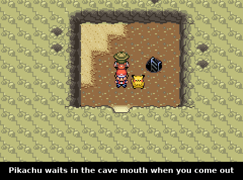

# Pokémon FireRed and LeafGreen

This is a fork of the PRET project with custom features. Development is AI-assisted (Claude Code) with human review and direction; [Autodev](#autodev) turns issues into PRs by itself, and each one waits for approval.

**Lost track of how it all works?** [docs/SYSTEM_MAP.md](docs/SYSTEM_MAP.md) shows on one page how autodev, the tests and the recordings fit together, with one line on every script. Every PR that changes them updates it.

## Added Features

- **Real-Time 4-Player Multiplayer** — Multi-player position sync via GBA Serial I/O, with remote player sprites on shared maps.

- **Procedurally Generated Mt. Moon** — Every visit to Mt. Moon builds a new cave on each of its three floors, drawn in that floor's own vanilla style, with every vanilla trainer, item and fossil on it and guaranteed reachable. Before/after renders, how it works and how it is tested: [Mt. Moon generator](#mt-moon-generator).
  - **Chain:** Mt. Moon is a chain of three generated floors, Route 4's west door ⇄ 1F ⇄ B1F ⇄ B2F ⇄ Route 4's east door: enter from the west door into 1F, drop through a hole to B1F, through another to B2F, and climb a ladder out of B2F to Route 4's east door, or walk it the other way. Each floor has exactly two ways out, one toward each end of the chain, and they are at least 24 tiles apart (east-west plus north-south). They sit the way vanilla Mt. Moon places them: 1F keeps vanilla's doorway at the bottom of the map, a way down is a hole in open floor, and a ladder up stands at the foot of a north wall, except on B2F, where both ladders up stand in open floor, as all of vanilla B2F's do.
  - **Saves:** Every fresh entry into a floor (through a door or a ladder) rolls a new cave seed, stored in the save, and the whole cave is built from that seed alone. Leaving a floor and coming back builds a new cave; battles and menus never do. A cave survives save and reload: Continue puts you back in the same cave, on the same tile, with every trainer and item where you left them. If a save's tile isn't walkable in the rebuilt cave (for example a save made before seeds existed), you are moved to the nearest reachable floor.
  - **Content:** Every trainer, NPC, item ball, hidden item and sign of vanilla Mt. Moon is on its own floor, and all of it is guaranteed reachable: from either ladder you can walk to the other ladder, to a tile facing every trainer, NPC, item, hidden item and sign, and to every floor tile of the cave. No object ever walls off part of a cave, not even a defeated trainer, who never moves again. Hidden items sit on a lone boulder as in vanilla, and trainers that stand still face down their longest straight corridor.
  - **Load time:** Entering a floor takes at most half a second longer than entering a vanilla cave of the same size.
  - **1F look:** 1F looks like vanilla 1F: open cave floor, about 60% of the map, with pink rock islands standing in it, inside vanilla's rock border. The islands are rectangles at least 3×3 tiles and 7-shaped L's, with at least 2 floor tiles between them; some stand against the west wall or on the south wall, as vanilla's do. Soft-edged sand patches sit in the corners, sometimes along the whole north wall with a patch hanging from it, sometimes out in the open. Every tile is drawn only next to tiles vanilla 1F itself puts beside it, so there are no visible seams, and the Zubat sign always stands on plain floor.
  - **B1F look:** B1F looks like vanilla B1F: rectangular rooms and corridors carved out of black void, each with a 2-row rock wall along its north side, and about a fifth of the map walkable (vanilla: 16%). Rooms at different heights join the way vanilla's do, with rubble where a lower wall ends beside a corridor. Every tile sits only next to tiles vanilla B1F also puts beside it, so there are no visible seams. The ladder up stands at the foot of a north wall and the hole down is in open floor.
  - **B2F look:** B2F looks like vanilla B2F: a cave divided into rooms by pink-topped ridges whose south side is a tall cliff face, with small walled rooms you climb into by 2-wide stairs cut into their one-row south wall, and about half the map walkable (vanilla: 46%). Ridges end, meet and open into gaps of dithered floor the way vanilla's do, and the fossil chamber is one of the rooms, hanging from the rock along the top of the map. Every tile sits only next to tiles vanilla B2F also puts beside it, apart from one tile pair at the chamber's top corner, so there are no visible seams. Unlike on the other floors, B2F's two ladders stand in open floor, as all of vanilla B2F's do.
  - **Fossil chamber:** B2F always has vanilla's fossil chamber, copied tile for tile. Super Nerd Miguel guards the Dome and Helix Fossils at the top of the stairs that are the only way in, and his battle trigger is the tile right next to him, so you can't reach the fossils without facing him. Wherever the chamber lands, it is guaranteed reachable from both ladders but never on the only way between them: it stays a side room, as in vanilla. Beat Miguel and take one fossil, and he walks over and takes the other. Leave and come back, and both fossils stay gone while Miguel is back at his post.
  - **Decorations:** Every floor is dotted with vanilla Mt. Moon's decorations, copied tile for tile: loose rubble (solid), 2×2 craters in the floor, and puddles with water dripping from the wall above them. Each floor gets between half and one and a half times as many of each as its vanilla map has (1F: 19 rubble tiles, 6 craters and 2 puddles; B1F: 14, 1 and 2; B2F: 7, 4 and 2). A decoration only goes where every tile beside it is one that floor's vanilla map also puts there, so none of them draws a seam, and rubble never blocks a path, a ladder or the tile in front of a trainer, item, hidden item or sign. On 1F, rubble lies in small heaps below rock faces (the rock islands' and the north wall's), and the puddles drip from the islands' south faces. On B1F, the rubble where a lower wall ends beside a corridor counts toward its rubble, puddles drip from north walls, and its one crater lies against the void west of a room or corridor, like vanilla's. On B2F, rubble lies alone on the open floor, puddles drip from the walled rooms' south walls, and the fossil chamber keeps its own rubble and puddle; the stairs into its rooms are part of B2F's look, not decorations.

  

  In real time: from Route 4 into 1F (rock islands and sand), down through B1F (rooms in black void) to B2F, into the fossil chamber for the Dome Fossil (Miguel already beaten), and out by B2F's ladder onto Route 4 east of the cave.

- **Quick Select Menu** — Press SELECT in the overworld to use HMs directly and access registered items from a single menu.

  

- **Slaveless HM Obstacles** — Pressing A at an HM obstacle (CUT tree, ROCK SMASH rock, STRENGTH boulder, water to SURF on, WATERFALL) works without a party Pokémon that knows the move. If no party member knows it but the player has the HM in the bag and the badge that allows it, the usual "Would you like to use it?" prompt appears; after YES, a mysterious Pokémon (a dark grey silhouette of a random species that can learn the move) appears on the field-move banner and uses it. Tested by `test/tests/test_slaveless_hm_obstacle.lua` (Cut, Surf, Strength indoors, Waterfall).

  

- **Character Select** — Choose your player character at the start of the game.

  

- **Cycle Anywhere** — Use the bicycle anywhere without restrictions.

  

- **Type Effectiveness Colors in Battle** — Move text in the FIGHT menu is colored by effectiveness: green for super effective, yellow for not very effective, red for no effect. In double battles, colors correctly reflect the currently targeted (alive) opponent and update in real-time as you move the target cursor between opponents.

  

- **Walk With Pokemon** — Your pokemon follows you around in the overworld. It only walks where you could: never through walls, onto people or water, or onto a ledge from the side; it hops down a ledge after you, and when it can't reach you (say you SURF across a pond) it waits, then appears beside you shortly after you're back on land. When you walk into a cave (Mt. Moon, Rock Tunnel, Victory Road, ...), you take one step into it once the screen fades in, so your Pokémon is left at the entrance instead of blocking your way. The step only happens when the tile ahead is open: at entrances that land you facing a wall, such as Rock Tunnel's north entrance or a Mt. Moon ladder, you stay where you arrived. Doors into buildings work as before, and if you ride in on a bike you stay on it. Walk into your Pokémon and you swap places, as in HeartGold and SoulSilver, whether you walk, run or ride, so it never blocks a door, a cave mouth or a narrow path. If you jump down a ledge or come ashore from SURF right where it stands, it steps aside.

  

  

- **Shiny Chaining (Gen 4 PokéRadar)** — Granted at game start. Use it in tall grass and four patches of grass nearby start shaking. Step into a shaking patch and a wild Pokémon jumps out at once, even with a Repel on; stepping off the grass makes the patches go. Defeating or catching the same species from patches builds a chain, boosting shiny odds up to ~1/200 at chain 40.

  

- **PP Items in Marts** — Ether, Max Ether, Elixir, and Max Elixir are now sold in Pokémon Marts, tiered to match the HP restorers already available: Ether/Max Ether alongside Super Potions, Elixir alongside Hyper Potions, Max Elixir alongside Max Potions.

  

- **PC Access from Anywhere** — "MOVE TO PC" option in the party menu deposits a Pokémon directly to the PC box. "BILL'S PC" in the Quick Select menu (SELECT button) opens the full PC storage system from anywhere outside battle.

  

- **L/R Page Scroll in Bag and Pokédex** — Press L or R while in the Bag item list or the Pokédex ordered list to page the cursor up or down by a full screen at a time. L clamps at the top of the list (no wrap-around).

  

## Tests

Every test is a Lua script in `test/tests/` that boots the ROM in mGBA's headless emulator and plays the game by pressing buttons and reading memory (`test/lib/framework.lua` explains how). Build first with `make -j$(nproc) firered`; the tests run `pokefirered.gba`.

```bash
bash test/run_suite.sh                                    # the whole suite: exit code 0 = every test passed
bash test/run_test.sh test/tests/test_pc_anywhere.lua     # one test: exit code 0 = pass, 1 = fail, 124 = timed out
bash test/record_test.sh test/tests/test_pc_anywhere.lua  # the same in the mGBA window, recorded to video
bash test/record_test.sh --notes notes.txt test/tests/test_pc_anywhere.lua  # recorded, with notes saying what it's for
```

**Recordings run one at a time.** `record_test.sh` films the whole virtual display and closes any other mGBA window, so it takes a machine-wide lock (`/tmp/autodev-record.lock`) first. A second recording started meanwhile, from any worktree, prints "Waiting for another recording to finish…" and starts once the first is done. `run_test.sh` and `run_suite.sh` don't need the display, so they run alongside a recording.

**Recordings don't use the machine's sound.** `record_test.sh` gives mGBA SDL's dummy audio output (`SDL_AUDIODRIVER=dummy`), so a hung or missing audio server can't stop the game before its first frame. The videos have no sound track anyway.

**Recordings are small enough to stream over Tailscale.** `record_test.sh` captures the screen live with fast settings that keep up with it but make big files, about 3 Mbps. Once the test ends and the next recording may start, `test/tools/encode_recording.sh` encodes the capture again, slowly and well, at low CPU priority. That script holds the settings, each explained for someone new to video encoding.

- The result is 5 to 8 times smaller, at the same size and frame rate, and the scripting window's log reads the same. #99's 104-second recording went from 39.9 MB to 4.9 MB. The encode takes 6 to 11 seconds per 100 seconds of video.
- The script's last lines say what it did, e.g. `captured 39.9 MB, kept 4.9 MB (0.38 Mbps)`. If the encode fails, the capture is kept as the video, and the script says so: no recording is lost.
- If videos still stutter over Tailscale, raise `-crf` in `test/tools/encode_recording.sh`: 30 to 32 is the next step, with softer text.

**Shrinking videos kept before this.** `bash test/tools/shrink_recordings.sh [FOLDER]` (default `~/recordings`) encodes each `.mp4` directly in the folder that isn't H.264 High profile yet, with the same settings:

- Each video keeps its name and modification time, which is when it was recorded, so ordering by time doesn't change.
- Each original moves into `originals/` in that folder, unchanged; the page doesn't list it. Put one back with `mv ~/recordings/originals/NAME ~/recordings/`, or delete them all with `rm -r ~/recordings/originals` once you're happy. A video put back is shrunk again by the next run, so keep one you want at full size for good somewhere else.
- A video it can't encode is left as it is, with a message: one that is damaged, or still being copied in. A second run changes nothing.
- Run it again after merging a branch made before #108: those branches still record the old way.

`test/tests/test_recording_size.lua` checks both scripts on synthetic captures made like the real one: the encode's profile, picture size, frame rate, index position, settings and file size; a broken or cut-short input; and the shrink tool's names, times, originals and second run.

**Recordings carry notes.** `--notes FILE` (or `--notes -` for stdin) gives a recording notes that say which ticket, feature (the parent issue) and PR it belongs to, what it tests, what the problem was and what you should see. The recordings page shows them on the recording's card:

```
ticket: 90 Shaking patches survive a field reload
parent: 87 The Poke Radar
pr: 97

## What's tested
The radar's four patches after closing the BAG or POKéMON, after Continue, and after a warp.

## The problem
Rebuilding the field destroyed the patch sprites, but the radar still counted them as live.

## What you should see
Four patches shake. The BAG opens and closes, and the same four still shake.
```

- **Headers.** The lines before the first `## ` heading are optional headers, each allowed once. `ticket:` and `parent:` take an issue number (with or without `#`), a space and its title; `pr:` takes a number. Any other key is refused, naming it.
- **Sections.** With notes, all three sections are required: each once, each with text, in any order. Any other `## ` heading is refused, naming it.
- **Plain text.** The page keeps the notes' line breaks and doesn't render Markdown.
- **Checked first.** `record_test.sh` checks the arguments and the notes before it waits for the recording lock or starts anything, and lists every problem it finds, so bad notes cost a second, not a recording. `bash test/record_test.sh --check --notes FILE TEST` only checks: it prints the verdict and the name the video would get, and exits 0 or 1 without recording. A test must never run `record_test.sh` without `--check`: a real recording closes every mGBA window on the machine.
- **The ticket in the name.** When the notes name a ticket, the video's name starts with it: `issue-90_test_poke_radar_patch_reload_20261020_134554.mp4`.
- **The notes file.** Every recording, with notes or without, gets `<name>.json` beside `<name>.mp4`, written by `test/tools/recording_notes.py`. It holds the notes and what the recorder knows itself: when it started, the test, the branch and commit as it started (and whether tracked files differed from that commit), and the run's pass and fail counts (`null` when the test didn't finish). The helper's header has the format.
- **The last two lines** are the command that keeps both files, and the recording's own page:

  ```
  mv /tmp/mgba-recordings/<name>.mp4 /tmp/mgba-recordings/<name>.json ~/recordings/
  http://100.76.129.86:8080/r/<name>
  ```
- **Autodev's sessions must write them.** In a session autodev started, `record_test.sh` (`--check` included) refuses to record without notes, and refuses notes whose `ticket:` isn't the session's own ticket or that have no `parent:`. So every recording on a PR says what it's for. A fix-up's notes get its PR's number by themselves. A ticket session records before its PR exists, so once it's open the session runs `python3 test/tools/recording_notes.py set-pr <name> <PR>`, which puts the number into that recording's notes file (in `~/recordings`, or else `/tmp/mgba-recordings`). Its PR links each recording's own page. When you record, notes stay optional.
- **Old recordings can get notes without moving.** A video kept before notes existed has no notes file. `python3 test/tools/recording_notes.py add-notes NAME NOTES [--test TEST]` writes one beside `~/recordings/NAME.mp4` (`--kept DIR` for another folder). `NAME` is as the page shows it, with or without `.mp4`; `NOTES` is a notes file in the usual format, or `-` for stdin; `TEST` is the test it recorded.
  - Its recording time comes from the `_<date>_<time>` stamp at the end of the video's name, else from the video's modification time, never from when the notes are added, so the card stays where it was on the page.
  - The branch, commit and result are `null`, because nobody knows them any more, and a `notes_added_at` field says when the notes were written. The card says "notes added <date>" where a result would be.
  - It refuses, changing nothing, a name with no such video, a video whose notes file `record_test.sh` wrote, a notes file it can't read, and notes with problems (it lists them all). It may rewrite notes it wrote itself, to fix them, keeping the recording time.
  - An autodev session's rules for notes don't apply to it, because an old video belongs to an old ticket.

`test/tests/test_recording_notes.lua` checks the notes `--check` accepts and refuses, the name, the notes file the helper writes, and how the page shows notes files, including broken ones. It also checks the rules for autodev's sessions, `set-pr`, and `add-notes`: its times, the page's order before and after, the card, its refusals and its rewrites.

**The recordings page.** `test/serve_recordings.py` shows the videos at http://100.76.129.86:8080 (`autodev-recordings.service` runs it):

- **Two sections, each newest first.** Kept recordings (`~/recordings`, kept for good) come first, then scratch ones (`/tmp/mgba-recordings`, not kept yet and cleared on reboot). "Newest" goes by when a recording was made: the time in its notes file, or, for a video without one, its modification time (when its recording ended, which `mv` keeps). Videos in subfolders aren't listed, and nor is a notes file without its video.
- **A card per video, from its notes file.** The title is the ticket, "#90 Shaking patches survive a field reload", linked to it; with no ticket in the notes, the test's name. Under it come "Part of #87 …" and "PR #97", each linked, when the notes name them. Then the three notes, under "What's tested", "The problem" and "What you should see": beside the video on a wide screen, above it on a phone. A small facts line says when it was recorded (this machine's time), the test, the branch and commit ("with uncommitted changes" when so), the result ("215 of 215 checks passed", "3 of 215 checks failed", "no checks: a demo or probe" or "no result: the test didn't finish"), the size, the file name, and a link to its own page. A recording made without notes says "No notes for this recording."
- **A card for an old video given notes with `add-notes`** looks the same, but its facts line says "notes added <date>" (this machine's time) where the result would be, and has no branch or commit: nobody knows them any more.
- **A card for a video without a notes file** (one recorded before notes existed) takes its title from the file name: `issue-24-safety-net.mp4` is "#24 safety net", linked to issue #24, and `issue-90_test_x_20261020_134554.mp4` is "#90 test_x". Other names lose only their `_<date>_<time>` ending: `test_follower_swap_20261020_145947.mp4` is "test_follower_swap". Its facts are when it was recorded, its size and its file name, and it says "No notes for this recording." A notes file that can't be read gets the same card, saying "notes file unreadable": no single file can break the page.
- **A page per recording.** `/r/<name>`, where `<name>` is the file name without `.mp4`, shows just that video, so a phone loads one video instead of all of them. It looks in `~/recordings` first, then `/tmp/mgba-recordings`, so a link made before a video was moved still works.
- **Videos stream.** The page answers requests in parallel and sends each video in pieces, so a seek, a second video or the page itself never waits behind a slow download.
- **Previewing a branch's page.** Port 8080 runs master's page. To see a branch's, run `python3 test/serve_recordings.py --port 8081` in that checkout and open http://100.76.129.86:8081. `--kept DIR` and `--scratch DIR` point it at other folders. `--print PATH` prints what a GET of `PATH` (`/` or `/r/<name>`) would return, status code first, without opening a port; `test/tests/test_recordings_page.lua` checks the page that way, on fixture folders of its own.
- **One file.** The server imports only Python's standard library, and reads the notes files itself rather than through the helper, because autodev restarts the page when a merge changes that one file.
- **Its address is WSL's.** 100.76.129.86 is WSL's own Tailscale address (`tailscale ip -4` in WSL). The server runs inside WSL, so the Windows machine's Tailscale address doesn't reach it. `test/tests/test_recordings_page.lua` checks that every page address in the repo uses WSL's.

**The whole suite.** `test/run_suite.sh` is the check a change must pass before it is merged:

- It runs every top-level `test/tests/*.lua` file through `run_test.sh`, 4 at a time, each with a time limit of 1500 seconds (`MGBA_TEST_TIMEOUT=1500`), and leaves out the tests listed in `test/suite_exclude.txt`. The whole run takes about 10 minutes.
- It ends with a summary: each test's result (`PASS`, `FAIL`, `TIMEOUT` or `SKIPPED`) and seconds, the totals, and the wall-clock time. It exits 0 only if every test it ran passed. A timeout is recognised by the exit code of `timeout` (124), not by how long the test took, because the PC may sleep in the middle of a run.
- Every test run gets its own `mgba-test.XXXXXX` folder in `/tmp` (or in `$TMPDIR`, if set). The suite deletes the folders of passing runs. It keeps the folder of each failing or timed-out run and prints its path in the summary; everything `run_test.sh` printed for that run is saved inside it as `run_test.log`.
- To run only some tests, name their files: `bash test/run_suite.sh test/tests/test_a.lua test/tests/test_b.lua`. The exclusion list still applies. `--help` lists the options for the time limit and the exclusion list.
- **Every exclusion needs a reason.** Each line of `test/suite_exclude.txt` is a test name (its file name without `.lua`), then a one-line reason. A line with no reason, or one naming a test that doesn't exist, stops the suite before it runs anything. The summary lists every excluded test as `SKIPPED` with its reason. Exclude a test only when running it in the suite can't prove anything: it needs a fixture made by hand (`test_roaming_route1` needs a Route 1 savestate), or it makes no assertions (the demos and probes below). A failing test is not a reason to exclude it.
- `test/tests/test_run_suite.lua` checks the runner itself: it runs `run_suite.sh` on the small scripts in `test/tests/suite_fixtures/` and checks the exit code, the summary and which folders are left.

**A test can only pass by proving something:**

- A test passes only if it made at least one assertion (`fw.assert_true`, `fw.assert_eq`, `fw.assert_neq`) and none of them failed. A test that reaches `fw.finish()` with zero assertions fails with "0 assertions", so a test whose checks were all skipped, or only logged, can't pass.
- If booting a new game to character select fails, the test fails with "boot to character select failed", even when it gives up before its first assertion. To check a test's failure path in about a second, fake that failure: `MGBA_TEST_FAKE_BOOT_FAILURE=1 bash test/run_test.sh test/tests/<test>.lua`.
- Demos and probes only make frames, screenshots or logs for a person to look at, so they assert nothing. Each one says so with `fw.allow_no_assertions(reason)` and then passes with zero assertions; a failed assertion, a crash or a failed boot still fails it. In `test/tests/` they are `demo_lr_page_scroll`, `demo_pc_anywhere`, `demo_pp_items_in_marts`, `demo_slaveless_hm`, `demo_type_effectiveness_colors` and `test_char_midwalk_screenshot`, plus `test_fast_forward_gui` when it skips itself under the headless emulator (in the mGBA window it asserts). In `test/tools/` they are `explore_route1`, `probe_route1_fixture` and `test_route1_movement`. The whole-suite run leaves the ones in `test/tests/` out (`test/suite_exclude.txt`); run them on their own, or record them with `record_test.sh`.
- `test/tests/test_framework_rules.lua` checks these rules: it runs the small scripts in `test/tests/framework_fixtures/` through `run_test.sh` and checks each exit code and message.

## Autodev

Autodev takes an issue from the board to a PR that is ready to merge, with nobody at the keyboard. It runs this repo's GitHub Issue Workflow (CLAUDE.md, steps 1–13) with headless Claude Code sessions (Claude running without a terminal, unattended) that act as a bot account. Nothing reaches master until you comment `/merge` on the PR. The design is on [#48](https://github.com/MinimalEffort07/pokefirered/issues/48), and [automation/README.md](automation/README.md) has every detail.

**What it does.** Add one of your issues to the **pokefirered autodev** board. Every 2 minutes a systemd user timer runs one *tick* of the dispatcher, which looks at the board and moves each card on:

1. A grill session designs the issue by itself, taking every recommended answer, posts the design on the issue, and breaks it into tickets.
2. Each ticket whose blockers are all closed gets its own worktree (a separate checkout of the repo on the ticket's own branch) and a ticket session: TDD, a clean build, `run_suite.sh`, a recording with notes if the game changes, the README and the system map, a code review, then a PR that @mentions you, says what changes for you and links each recording's page.
3. Your feedback on the PR starts a fix-up session. Your `/merge` starts a merge session, which merges master in, tests that exact tree again, and merges with a merge commit. If merging master in conflicts, it resolves the conflict, explains how on the PR, and waits for a fresh `/merge` from you instead of merging.
4. Once every ticket of the issue is closed, the issue is closed too.

At most 2 sessions run at once, and the issue grilled first keeps first call on the slots: a later issue's tickets wait while it has one ready. Only your issues, and the tickets the bot writes for them, are run, and only your text and the bot's ever reaches a session: anyone else's issue is parked, and their comments are withheld. When a session hits the Claude usage limit, nothing starts until shortly after the limit resets; a crashed session is run once more before it is parked.

**Setup.** Run two scripts, both safe to run again:

```bash
bash automation/wizard.sh   # what only a person can do: the bot account and its token, gh's project scope, the Windows logon task
bash automation/setup.sh    # the rest: the board, the bot's access, the master rulesets, autodev's own clone, the systemd units
```

**The board.** Each card's Status says where it is:

| Status | Meaning |
|---|---|
| `Todo` | Waiting for the dispatcher. A card with no Status counts as `Todo`. |
| `Grilling` | A parent issue is being grilled. |
| `Blocked` | A ticket is waiting for an issue under its `## Blocked by` heading to close. |
| `In progress` | A parent's tickets are in flight, or a session is running for a ticket. |
| `In review` | A ticket's PR is waiting for your `/merge` or your feedback. |
| `Needs human` | Parked, after a failure or because someone else wrote the issue. The bot's latest comment says why. A parked ticket of yours comes back on its own once its PR is opened or you comment on it (see below). |
| `Paused` | Your stop switch for that card. |
| `Done` | Closed. |

**What you do:**

- **Approve a merge:** comment exactly `/merge` on the PR. It counts only while it is the last thing you've said there. After a merge session resolves a conflict, check its explanation and comment `/merge` again.
- **Give feedback:** leave any other comment, review or inline comment on the PR. A fix-up session deals with everything you've said, pushes, and replies; then the PR waits for you again. Feedback after a `/merge` cancels it.
- **Pause one item:** set its card, or its parent's, to `Paused`. Nothing new starts for it, and a session already running finishes its run. Move the card back to `Todo` to carry on. To end a running session early, pause its card first, then `systemctl --user stop autodev-<role>-<issue>` (e.g. `autodev-ticket-68`); a stop on its own counts as a crash, so the work would run once more.
- **Stop everything:** `systemctl --user stop autodev.timer` stops the ticks until the next restart; `systemctl --user disable --now autodev.timer` stops them for good, and `enable --now` starts them again. Sessions already running carry on: `systemctl --user list-units 'autodev-*'` lists them.

**Logs.** Each tick logs what it saw and did to the journal: `journalctl --user -u autodev-dispatcher -f`. Each session's full log is `~/autodev/logs/<role>-<issue>-<time>.jsonl`, kept for 30 days.

**Resuming a parked session.** When a session fails, its `Needs human` comment @mentions you, says what went wrong, and ends with a command that reopens the session interactively, exactly where it stopped:

```bash
cd ~/projects/minimaleffort/pokefirered-autodev-worktrees/issue-68 && (set -a && . ~/.config/autodev/env && set +a && AUTODEV_ROLE=ticket AUTODEV_ISSUE=68 CLAUDE_CONFIG_DIR=~/.claude-personal claude --resume <session-id>)
```

The resumed session is still that session: it acts as the bot (the token loads only inside the brackets, not in your shell) and `issue.py` knows its role and issue, so it can finish the job, e.g. open the ticket's PR.

Once it's sorted, hand it back:
- **A ticket comes back on its own.** Once its PR is opened (by the resumed session, or by you from the ticket's `issue-<T>-*` branch), it goes to `In review`. Your `/merge` or feedback on its PR starts a merge or fix-up straight away, as in review. Only what happens after it was parked counts, so the comment it was parked over doesn't start the same work again.
- **Or move the card back to `Todo`.** Autodev carries on from where things stand: a parent that already has tickets isn't grilled again, and a ticket whose PR is open goes back to `In review`.

**Demo.** The demo is the canary, [#83](https://github.com/MinimalEffort07/pokefirered/issues/83), a throwaway issue that runs the whole flow on the live board: it is grilled into tickets, implemented in a PR, fixed up after one comment from you, and merged after your `/merge`. The canary passed: apart from that one comment and that `/merge`, it went from grilling to merge on its own.

## Mt. Moon generator

### Before and after

Whole floors, drawn with the game's own tiles by `test/tools/render_cave.py` (see [Renders and the demo](#renders-and-the-demo)). Only the map's tiles are drawn: trainers, item balls and the player are sprites, not map tiles, so they don't appear. The coordinates along the edges are map tiles. **Before** is the old generator, from maps dumped out of the game while this rework was designed (issue #22). **After** is this generator: the caves the demo GIF walks through, cave seeds 0x2cba (1F), 0xe6e7 (B1F) and 0x64f4 (B2F).

| | Before | After |
|---|---|---|
| **1F** | <br>Floor carved out of solid rock, the rock drawn mostly with one striped tile, sand as single-tile speckles, and sealed pockets you can't walk into. Its exit led straight to Route 4 east. | <br>Open floor with pink rock islands, soft-edged sand, rubble, craters and puddles, inside vanilla's rock border. The hole down is at (20,14). |
| **B1F** | <br>The same stripes and speckles. Its exit led to Route 4 west, and a stray pink column filled its 49th column. | <br>Rooms and corridors in black void, each with a 2-row wall on its north side, joined by rubble where a lower wall ends. |
| **B2F** | <br>**Never generated, never reached.** Neither old floor led to B2F, so this vanilla map, with the fossils, Super Nerd Miguel and four Team Rocket grunts, sat unused. | <br>Terraces divided by pink-topped ridges, walled rooms entered by stairs, ladders standing in open floor, and the fossil chamber hanging from the rock at the top right. |

The vanilla maps, for comparison: [1F](images/mt_moon/vanilla_1F.png), [B1F](images/mt_moon/vanilla_B1F.png), [B2F](images/mt_moon/vanilla_B2F.png).

### How it works

The generator runs each time the player enters a Mt. Moon floor or continues a save there, during the black screen while the map loads. `src/fieldmap.c` calls it right after the floor's vanilla map has been copied into the game's map buffer, and it overwrites that copy; the map data in the ROM never changes. Some GBA background helps here:

- A map is a grid of **metatiles**, 16 × 16-pixel pictures. In memory each map cell is a 16-bit number: `metatile id | collision << 10 | elevation << 12`, so `0x3281` is cave floor (metatile `0x281`, walkable, at the floor's height 3). Drawing a floor means writing these numbers.
- The GBA has two small work memories, 32 KB of fast **IWRAM** and 256 KB of **EWRAM**, and this game uses almost all of both. So the generator keeps 16 bytes of state in IWRAM and a few event tables in EWRAM, and borrows its working grid (about 8–10 KB) from the game's heap only while a floor is being built.
- All of this runs in one go while the screen is black, so it must be fast: a floor may take at most 30 frames (half a second at the GBA's 60 frames per second) longer to load than an untouched vanilla cave (test P9).

How one floor is built (`GenerateFloor` in `src/mt_moon_gen.c`):

1. **Seed.** A fresh entry rolls a 16-bit seed with the game's `Random()` and stores it in `VAR_MT_MOON_MAP_SEED`, a game variable, so it is saved with the game; Continue reads it back. From here on every random choice comes from the generator's own random number generator, seeded from that value and the floor number, never from `Random()`. (The game advances `Random()` every frame, so anything drawn from it would come out different on Continue.)
2. **Shape.** The core proposes where the floor's two ladders (and, on B2F, the fossil chamber) go. The floor's **style** carves the cave out of solid wall around them, moving them if it likes.
3. **Checks and repairs.** The core checks the ladders, stamps the fossil chamber (a 13 × 9 block of vanilla B2F's tiles) and turns any floor the player can't walk to into wall.
4. **Content.** Every vanilla trainer, NPC, item ball, hidden item and sign gets a spot where it keeps the floor in one piece and the player can stand in front of it; where nothing fits, the core carves open floor.
5. **Drawing.** The style picks the tile for every cell; then come the stamped one-tile pieces (hidden items' boulders, the sign), the fossil chamber, and the decorations.
6. **Final check.** One last flood fill confirms that both ladders, every floor tile and every piece of content can be reached. Then each trainer that stands still is turned toward its longest open line of sight.

If a shape fails a check, the style builds a new one; after 4 failures the floor stays the vanilla map, which is fully playable. In the tests this has never happened.

**Where to look.** The core is the same for every floor; a style decides only what a floor looks like.

| File | What it holds |
|---|---|
| `include/mt_moon_gen.h` | The three entry points `src/fieldmap.c` calls: fresh entry, Continue, and "is this a generated floor". |
| `src/mt_moon_gen.c` | The core. Its OVERVIEW comment walks through all of it: the floor table (the chain, ladder kinds, vanilla decorations), the seed and random numbers, the grid, ladders, the fossil chamber, pocket filling, content placement, decorations, warps and the Continue safety net. |
| `include/mt_moon_gen_style.h` | The contract between the core and a style: the grid, the ladder and chamber rules a style must keep, one-tile prefabs and map cell values. Start here to change a floor's look. |
| `src/mt_moon_style_1f.c` | 1F: rock islands in open floor, soft-edged sand. |
| `src/mt_moon_style_b1f.c` | B1F: rooms and corridors in black void. |
| `src/mt_moon_style_b2f.c` | B2F: ridges, walled rooms with stairs, freestanding ladders, the chamber's place. |
| `data/maps/MtMoon_*/map.json`, `data/maps/Route4/map.json` | The warps. B2F's warp 1 and Route 4's warp 1 point at each other; every other link is vanilla's. |

"Looks like vanilla" is checked, not eyeballed: test P5 compares every pair of neighbouring tiles (north-south and east-west) on a generated floor with the pairs that floor's vanilla map (`data/layouts/MtMoon_<floor>/map.bin`) contains, and allows exactly one pair vanilla doesn't have: rock above the top-right corner of B2F's fossil chamber.

### Tests

Each test boots the ROM in mGBA's headless emulator and drives the game from a Lua script (see `test/run_test.sh`). Build first with `make -j$(nproc) firered`; the tests run `pokefirered.gba`.

```bash
# Property checks: every generated floor, 100 seeds each (about 3 minutes;
# the limit is generous)
MGBA_TEST_TIMEOUT=1500 bash test/run_test.sh test/tests/test_mt_moon_properties.lua
# One floor, one check, or one random state, e.g. to reproduce a logged failure
MT_MOON_FLOORS=B2F MT_MOON_CHECKS=P5-B2F MT_MOON_RNG=0x12345678 \
    bash test/run_test.sh test/tests/test_mt_moon_properties.lua
# A scenario
MGBA_TEST_TIMEOUT=300 bash test/run_test.sh test/tests/test_mt_moon_walk_east.lua
```

**Property checks** (`test/tests/test_mt_moon_properties.lua`): it enters each floor with 100 different random states and runs every check in `test/tests/mt_moon_checks/` on each cave. A new check is a new file in that directory.

| Check | Passes when |
|---|---|
| P1 ladders | Exactly 2 active warps, each on its ladder's or door's tiles, at least 24 tiles apart |
| P2 reachable | From either ladder, with every object (and a wanderer's whole roaming box) solid: the other ladder, a tile facing every object, hidden item and sign, and Miguel's trigger can be reached; every hidden item sits on a boulder |
| P3 no pockets | Every walkable tile that no object stands on can be reached |
| P4 content complete | Every vanilla object, hidden item, sign and trigger tile is on the floor, none at (0,0), none sharing a tile or on a warp |
| P5 looks right | 0 neighbouring tile pairs missing from that floor's vanilla map (one allowed B2F pair, above) |
| P6 density | Walkable share of the map: 1F 50–70%, B1F 15–30%, B2F 36–56% |
| P7 trainer facing | Each trainer that stands still faces its longest straight run of open floor |
| P8 determinism | Entering again with the same random state builds the identical map and object positions |
| P9 load time | At most 30 frames slower than entering Rock Tunnel 1F, a vanilla cave of the same size |
| P10 decorations | Rubble, craters and puddles each between ½ and 1½ times vanilla's count |
| FC fossil chamber | B2F's chamber is vanilla's tiles, with Miguel, both fossils and his trigger in place; no fossil can be reached without stepping on the trigger; the ladders connect without the chamber |
| SAND-1F | 1F's sand comes in soft-edged patches of at least 3 × 3 |
| B1F-W | B1F is generated across its full 49-tile width |

**Scenarios** (one file each in `test/tests/`; every step is a real D-pad press planned by `test/lib/walk.lua`, and every Mt. Moon trainer is first marked defeated):

| # | File | Passes when |
|---|---|---|
| S1 | `test_mt_moon_walk_east.lua` | Walking Route 4 west → 1F → B1F → B2F → Route 4 east arrives on each expected warp, ending on Route 4 at (32,5) |
| S2 | `test_mt_moon_walk_west.lua` | The same walk the other way ends on Route 4 at (19,5) |
| S3 | `test_mt_moon_miguel_trigger.lua` | Stepping on Miguel's trigger (Miguel not yet beaten) starts his battle |
| S4 | `test_mt_moon_fossil_dome.lua` | Taking the Dome Fossil sets its flags and puts it in the bag; Miguel walks to the Helix Fossil and takes it |
| S5 | `test_mt_moon_fossil_helix.lua` | The same with the Helix Fossil |
| S6 | `test_mt_moon_save_continue.lua` | Saving and continuing on each floor rebuilds the same map, seed and object positions |
| S7 | `test_mt_moon_fossil_dome.lua` | Leaving B2F after taking a fossil and coming back builds a new cave, both fossils stay gone and Miguel is back at his post |
| S8 | `test_mt_moon_items.lua` | 1F's Moon Stone ball and B2F's hidden Moon Stone can be picked up, and the ball is gone on re-entry |
| S9 | `test_mt_moon_safety_net.lua` | Continuing a save made inside a wall puts the player on reachable floor |

### Renders and the demo

`test/tools/render_cave.py` draws a whole map to a PNG with the game's own tile graphics and palettes, read straight from the repo's source files (`tiles.png`, `palettes/*.pal`, `metatiles.bin`), so it needs Python 3 and nothing else, not even a build. Its header lists everything it reads.

```bash
# A vanilla map
python3 -I test/tools/render_cave.py data/layouts/MtMoon_B2F/map.bin -o vanilla_B2F.png
# A generated cave: dump it from the running game by seed, then render the dump
MT_MOON_DUMP_FLOORS=B2F MT_MOON_DUMP_SEEDS=0x64f4 bash test/run_test.sh test/tools/dump_mtmoon_grid.lua
python3 -I test/tools/render_cave.py /tmp/mgba-test.XXXXXX/MtMoon_B2F_64f4.txt -o after_B2F.png
```

`run_test.sh` prints the run's output directory (`/tmp/mgba-test.XXXXXX`). With no settings, `dump_mtmoon_grid.lua` dumps the three "after" caves above. The demo GIF is `test/tests/demo_mt_moon.lua`, which is also a test of its own story (the arrival on every floor, the fossil, Miguel, under 45 seconds); its header has the commands that record it and turn it into the GIF.

This is a decompilation of English Pokémon FireRed and LeafGreen.

It builds the following ROM images:

* [**pokefirered.gba**](https://datomatic.no-intro.org/?page=show_record&s=23&n=1616) `sha1: 41cb23d8dccc8ebd7c649cd8fbb58eeace6e2fdc`
* [**pokeleafgreen.gba**](https://datomatic.no-intro.org/?page=show_record&s=23&n=1617) `sha1: 574fa542ffebb14be69902d1d36f1ec0a4afd71e`
* [**pokefirered_rev1.gba**](https://datomatic.no-intro.org/?page=show_record&s=23&n=1672) `sha1: dd5945db9b930750cb39d00c84da8571feebf417`
* [**pokeleafgreen_rev1.gba**](https://datomatic.no-intro.org/index.php?page=show_record&s=23&n=1668) `sha1: 7862c67bdecbe21d1d69ce082ce34327e1c6ed5e`
* [**pokefirered_switch.gba**](https://datomatic.no-intro.org/index.php?page=show_record&s=23&n=x550) `sha1: baa452d0b24629dd7782cfc07a8984085dde1311`
* [**pokeleafgreen_switch.gba**](https://datomatic.no-intro.org/index.php?page=show_record&s=23&n=x551) `sha1: 62b9fc77549dbc67032eb6cbd0ea6ad3b825690f`

To set up the repository, see [INSTALL.md](INSTALL.md).

For contacts and other pret projects, see [pret.github.io](https://pret.github.io/).
