# Pokémon FireRed and LeafGreen

This is a fork of the PRET project with custom features. Development is AI-assisted (Claude Code) with human review and direction.

## Added Features

- **Real-Time 4-Player Multiplayer** — Multi-player position sync via GBA Serial I/O, with remote player sprites on shared maps.

- **Procedurally Generated Mt. Moon** — Every visit to Mt. Moon builds a new cave on each of its three floors, drawn in that floor's own vanilla style, with every vanilla trainer, item and fossil on it and guaranteed reachable. Before/after renders, how it works and how it is tested: [Mt. Moon generator](#mt-moon-generator).
  - **Chain:** Mt. Moon is a chain of three generated floors, Route 4's west door ⇄ 1F ⇄ B1F ⇄ B2F ⇄ Route 4's east door: enter from the west door into 1F, drop through a hole to B1F, through another to B2F, and climb a ladder out of B2F to Route 4's east door, or walk it the other way. Each floor has exactly two ways out, one toward each end of the chain, and they are at least 24 tiles apart (east-west plus north-south). They sit the way vanilla Mt. Moon places them: 1F keeps vanilla's doorway at the bottom of the map, a way down is a hole in open floor, and a ladder up stands at the foot of a north wall, except on B2F, where both ladders up stand in open floor, as all of vanilla B2F's do.
  - **Saves:** Every fresh entry into a floor (through a door or a ladder) rolls a new cave seed, stored in the save, and the whole cave is built from that seed alone. Leaving a floor and coming back builds a new cave; battles and menus never do. A cave survives save and reload: Continue puts you back in the same cave, on the same tile, with every trainer and item where you left them. If a save's tile isn't walkable in the rebuilt cave (for example a save made before seeds existed), you are moved to the nearest reachable floor.
  - **Content:** Every trainer, NPC, item ball, hidden item and sign of vanilla Mt. Moon is on its own floor, and all of it is guaranteed reachable: from either ladder you can walk to the other ladder, to a tile facing every trainer, NPC, item, hidden item and sign, and to every floor tile of the cave. No object ever walls off part of a cave, not even a defeated trainer, who never moves again. Hidden items sit on a lone boulder as in vanilla, and trainers that stand still face down their longest straight corridor.
  - **Load time:** Entering a floor takes at most half a second longer than entering a vanilla cave of the same size.
  - **1F look:** 1F looks like vanilla 1F: open cave floor, about 60% of the map, with pink rock islands standing in it, inside vanilla's rock border. The islands are rectangles at least 3×3 tiles and 7-shaped L's, with at least 2 floor tiles between them; some stand against the west wall or on the south wall, as vanilla's do. Soft-edged sand patches sit in the corners, sometimes along the whole north wall with a patch hanging from it, sometimes out in the open. Every tile is drawn only next to tiles vanilla 1F itself puts beside it, so there are no visible seams, and the Zubat sign always stands on plain floor.
  - **B1F look:** B1F looks like vanilla B1F: rectangular rooms and corridors carved out of black void, each with a 2-row rock wall along its north side, and about a fifth of the map walkable (vanilla: 16%). Rooms at different heights join the way vanilla's do, with rubble where a lower wall ends beside a corridor. Every tile sits only next to tiles vanilla B1F also puts beside it, so there are no visible seams. The ladder up stands at the foot of a north wall and the hole down is in open floor.
  - **B2F look:** B2F looks like vanilla B2F: a cave divided into rooms by pink-topped ridges whose south side is a tall cliff face, with small walled rooms you climb into by 2-wide stairs cut into their one-row south wall, and about half the map walkable (vanilla: 46%). Ridges end, meet and open into gaps of dithered floor the way vanilla's do, and the fossil chamber is one of the rooms, hanging from the rock along the top of the map. Every tile sits only next to tiles vanilla B2F also puts beside it, apart from one tile pair at the chamber's top corner, so there are no visible seams. Unlike on the other floors, B2F's two ladders stand in open floor, as all of vanilla B2F's do.
  - **Fossil chamber:** B2F always has vanilla's fossil chamber, copied tile for tile. Super Nerd Miguel guards the Dome and Helix Fossils at the top of the stairs that are the only way in, and his battle trigger is the tile right next to him, so you can't reach the fossils without facing him. Wherever the chamber lands, it is guaranteed reachable from both ladders but never on the only way between them: it stays a side room, as in vanilla. Beat Miguel and take one fossil, and he walks over and takes the other. Leave and come back, and both fossils stay gone while Miguel is back at his post.
  - **Decorations:** Every floor is dotted with vanilla Mt. Moon's decorations, copied tile for tile: loose rubble (solid), 2×2 craters in the floor, and puddles with water dripping from the wall above them. Each floor gets between half and one and a half times as many of each as its vanilla map has (1F: 19 rubble tiles, 6 craters and 2 puddles; B1F: 14, 1 and 2; B2F: 7, 4 and 2). A decoration only goes where every tile beside it is one that floor's vanilla map also puts there, so none of them draws a seam, and rubble never blocks a path, a ladder or the tile in front of a trainer, item, hidden item or sign. On 1F, rubble lies in small heaps below rock faces (the rock islands' and the north wall's), and the puddles drip from the islands' south faces. On B1F, the rubble where a lower wall ends beside a corridor counts toward its rubble, puddles drip from north walls, and its one crater lies against the void west of a room or corridor, like vanilla's. On B2F, rubble lies alone on the open floor, puddles drip from the walled rooms' south walls, and the fossil chamber keeps its own rubble and puddle; the stairs into its rooms are part of B2F's look, not decorations.

  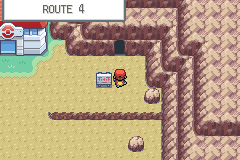

  In real time: from Route 4 into 1F (rock islands and sand), down through B1F (rooms in black void) to B2F, into the fossil chamber for the Dome Fossil (Miguel already beaten), and out by B2F's ladder onto Route 4 east of the cave.

- **Quick Select Menu** — Press SELECT in the overworld to use HMs directly and access registered items from a single menu.

  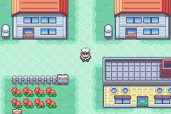

- **Slaveless HM Obstacles** — Pressing A at an HM obstacle (CUT tree, ROCK SMASH rock, STRENGTH boulder, water to SURF on, WATERFALL) works without a party Pokémon that knows the move. If no party member knows it but the player has the HM in the bag and the badge that allows it, the usual "Would you like to use it?" prompt appears; after YES, a mysterious Pokémon (a dark grey silhouette of a random species that can learn the move) appears on the field-move banner and uses it. Tested by `test/tests/test_slaveless_hm_obstacle.lua` (Cut, Surf, Strength indoors, Waterfall).

  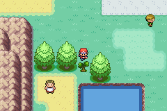

- **Character Select** — Choose your player character at the start of the game.

  

- **Cycle Anywhere** — Use the bicycle anywhere without restrictions.

  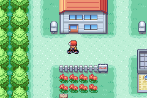

- **Type Effectiveness Colors in Battle** — Move text in the FIGHT menu is colored by effectiveness: green for super effective, yellow for not very effective, red for no effect. In double battles, colors correctly reflect the currently targeted (alive) opponent and update in real-time as you move the target cursor between opponents.

  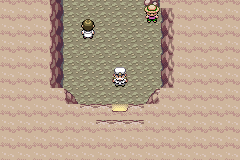

- **Walk With Pokemon** — Your pokemon follows you around in the overworld. It only walks where you could: never through walls, onto people or water, or onto a ledge from the side; it hops down a ledge after you, and when it can't reach you (say you SURF across a pond) it waits, then appears beside you shortly after you're back on land. When you walk into a cave (Mt. Moon, Rock Tunnel, Victory Road, ...), you take one step into it once the screen fades in, so your Pokémon is left at the entrance instead of blocking your way. The step only happens when the tile ahead is open: at entrances that land you facing a wall, such as Rock Tunnel's north entrance or a Mt. Moon ladder, you stay where you arrived. Doors into buildings work as before, and if you ride in on a bike you stay on it.

  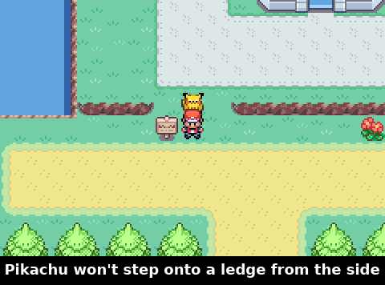

- **Shiny Chaining (Gen 4 PokéRadar)** — Granted at game start. Use in tall grass to spawn shaking patches; defeating or catching the same species from patches builds a chain, boosting shiny odds up to ~1/200 at chain 40.

  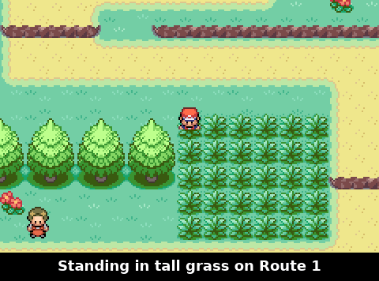

- **PP Items in Marts** — Ether, Max Ether, Elixir, and Max Elixir are now sold in Pokémon Marts, tiered to match the HP restorers already available: Ether/Max Ether alongside Super Potions, Elixir alongside Hyper Potions, Max Elixir alongside Max Potions.

  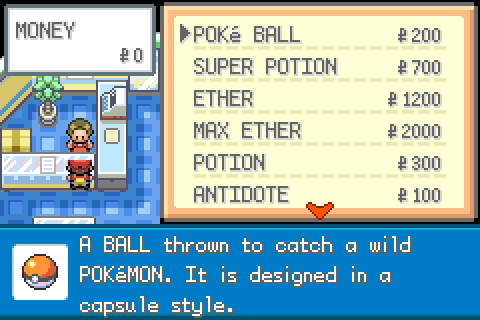

- **PC Access from Anywhere** — "MOVE TO PC" option in the party menu deposits a Pokémon directly to the PC box. "BILL'S PC" in the Quick Select menu (SELECT button) opens the full PC storage system from anywhere outside battle.

  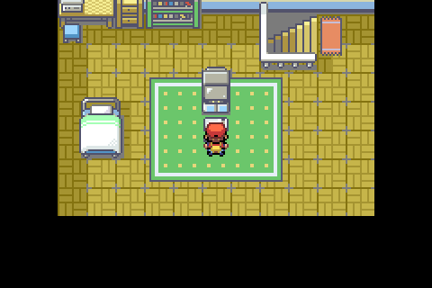

- **L/R Page Scroll in Bag and Pokédex** — Press L or R while in the Bag item list or the Pokédex ordered list to page the cursor up or down by a full screen at a time. L clamps at the top of the list (no wrap-around).

  

## Tests

Every test is a Lua script in `test/tests/` that boots the ROM in mGBA's headless emulator and plays the game by pressing buttons and reading memory (`test/lib/framework.lua` explains how). Build first with `make -j$(nproc) firered`; the tests run `pokefirered.gba`.

```bash
bash test/run_suite.sh                                    # the whole suite: exit code 0 = every test passed
bash test/run_test.sh test/tests/test_pc_anywhere.lua     # one test: exit code 0 = pass, 1 = fail, 124 = timed out
bash test/record_test.sh test/tests/test_pc_anywhere.lua  # the same in the mGBA window, recorded to video
```

**The whole suite.** `test/run_suite.sh` is the check a change must pass before it is merged:

- It runs every top-level `test/tests/*.lua` file through `run_test.sh`, 4 at a time, each with a time limit of 1500 seconds (`MGBA_TEST_TIMEOUT=1500`), and leaves out the tests listed in `test/suite_exclude.txt`. The whole run takes about 10 minutes.
- It ends with a summary: each test's result (`PASS`, `FAIL`, `TIMEOUT` or `SKIPPED`) and seconds, the totals, and the wall-clock time. It exits 0 only if every test it ran passed. A timeout is recognised by the exit code of `timeout` (124), not by how long the test took, because the PC may sleep in the middle of a run.
- Every test run gets its own `mgba-test.XXXXXX` folder in `/tmp` (or in `$TMPDIR`, if set). The suite deletes the folders of passing runs. It keeps the folder of each failing or timed-out run and prints its path in the summary; everything `run_test.sh` printed for that run is saved inside it as `run_test.log`.
- To run only some tests, name their files: `bash test/run_suite.sh test/tests/test_a.lua test/tests/test_b.lua`. The exclusion list still applies. `--help` lists the options for the time limit and the exclusion list.
- **Every exclusion needs a reason.** Each line of `test/suite_exclude.txt` is a test name (its file name without `.lua`), then a one-line reason. A line with no reason, or one naming a test that doesn't exist, stops the suite before it runs anything. The summary lists every excluded test as `SKIPPED` with its reason. Exclude a test only when running it in the suite can't prove anything: it needs a fixture made by hand (`test_roaming_route1` needs a Route 1 savestate), or it makes no assertions (the demos and probes below). A failing test is not a reason to exclude it.
- `test/tests/test_run_suite.lua` checks the runner itself: it runs `run_suite.sh` on the small scripts in `test/tests/suite_fixtures/` and checks the exit code, the summary and which folders are left.

**A test can only pass by proving something:**

- A test passes only if it made at least one assertion (`fw.assert_true`, `fw.assert_eq`, `fw.assert_neq`) and none of them failed. A test that reaches `fw.finish()` with zero assertions fails with "0 assertions", so a test whose checks were all skipped, or only logged, can't pass.
- If booting a new game to character select fails, the test fails with "boot to character select failed", even when it gives up before its first assertion. To check a test's failure path in about a second, fake that failure: `MGBA_TEST_FAKE_BOOT_FAILURE=1 bash test/run_test.sh test/tests/<test>.lua`.
- Demos and probes only make frames, screenshots or logs for a person to look at, so they assert nothing. Each one says so with `fw.allow_no_assertions(reason)` and then passes with zero assertions; a failed assertion, a crash or a failed boot still fails it. In `test/tests/` they are `demo_lr_page_scroll`, `demo_pc_anywhere`, `demo_pp_items_in_marts`, `demo_slaveless_hm`, `demo_type_effectiveness_colors` and `test_char_midwalk_screenshot`, plus `test_fast_forward_gui` when it skips itself under the headless emulator (in the mGBA window it asserts). In `test/tools/` they are `explore_route1`, `probe_route1_fixture` and `test_route1_movement`. The whole-suite run leaves the ones in `test/tests/` out (`test/suite_exclude.txt`); run them on their own, or record them with `record_test.sh`.
- `test/tests/test_framework_rules.lua` checks these rules: it runs the small scripts in `test/tests/framework_fixtures/` through `run_test.sh` and checks each exit code and message.

## Mt. Moon generator

### Before and after

Whole floors, drawn with the game's own tiles by `test/tools/render_cave.py` (see [Renders and the demo](#renders-and-the-demo)). Only the map's tiles are drawn: trainers, item balls and the player are sprites, not map tiles, so they don't appear. The coordinates along the edges are map tiles. **Before** is the old generator, from maps dumped out of the game while this rework was designed (issue #22). **After** is this generator: the caves the demo GIF walks through, cave seeds 0x2cba (1F), 0xe6e7 (B1F) and 0x64f4 (B2F).

| | Before | After |
|---|---|---|
| **1F** | 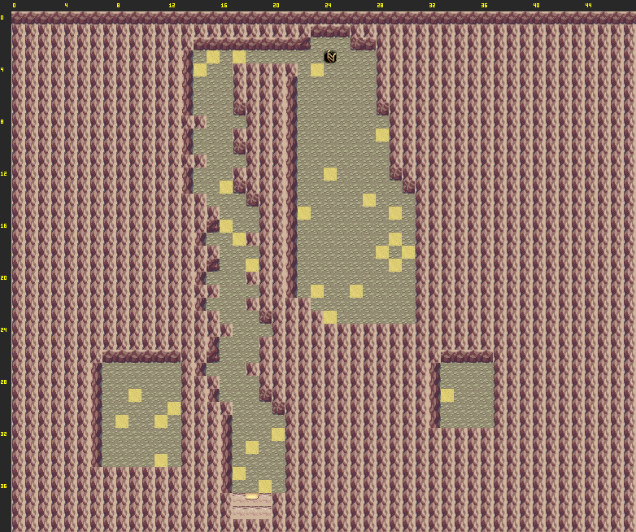<br>Floor carved out of solid rock, the rock drawn mostly with one striped tile, sand as single-tile speckles, and sealed pockets you can't walk into. Its exit led straight to Route 4 east. | 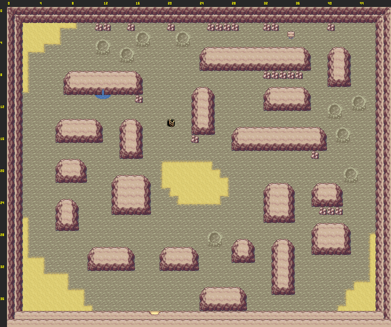<br>Open floor with pink rock islands, soft-edged sand, rubble, craters and puddles, inside vanilla's rock border. The hole down is at (20,14). |
| **B1F** | 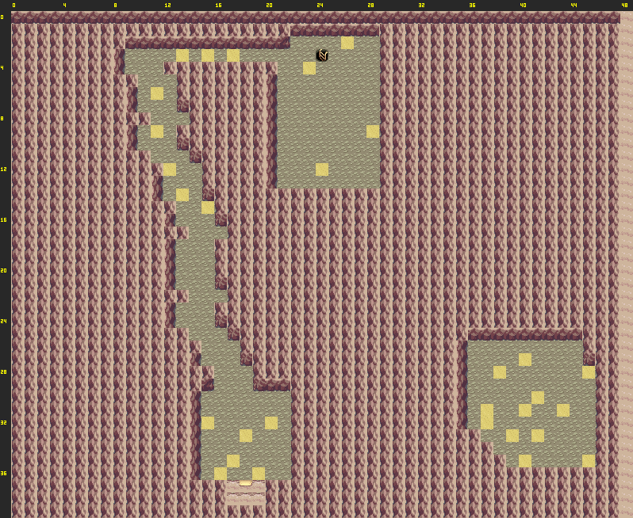<br>The same stripes and speckles. Its exit led to Route 4 west, and a stray pink column filled its 49th column. | 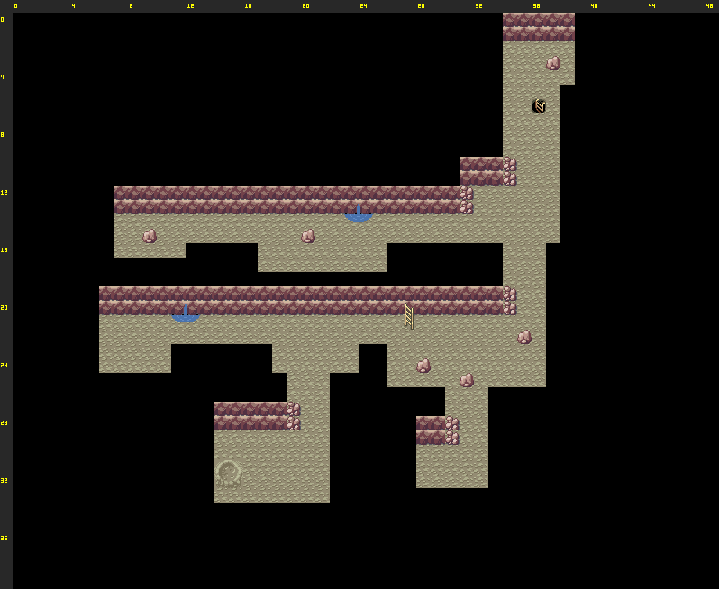<br>Rooms and corridors in black void, each with a 2-row wall on its north side, joined by rubble where a lower wall ends. |
| **B2F** | 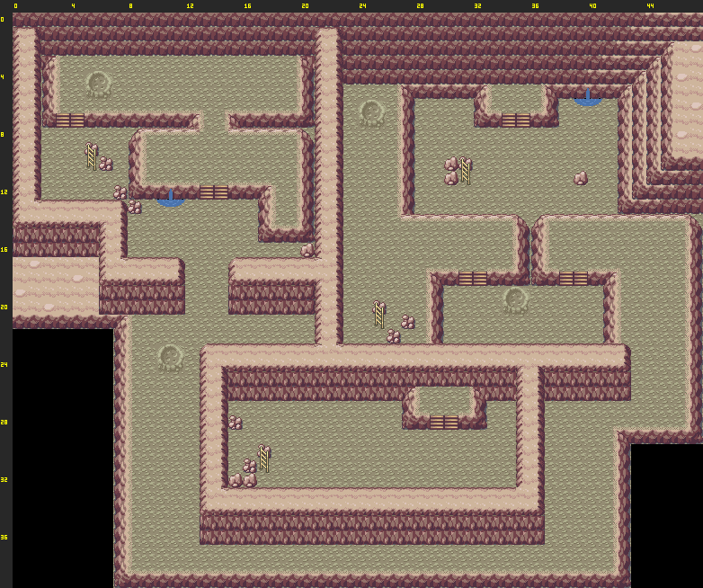<br>**Never generated, never reached.** Neither old floor led to B2F, so this vanilla map, with the fossils, Super Nerd Miguel and four Team Rocket grunts, sat unused. | 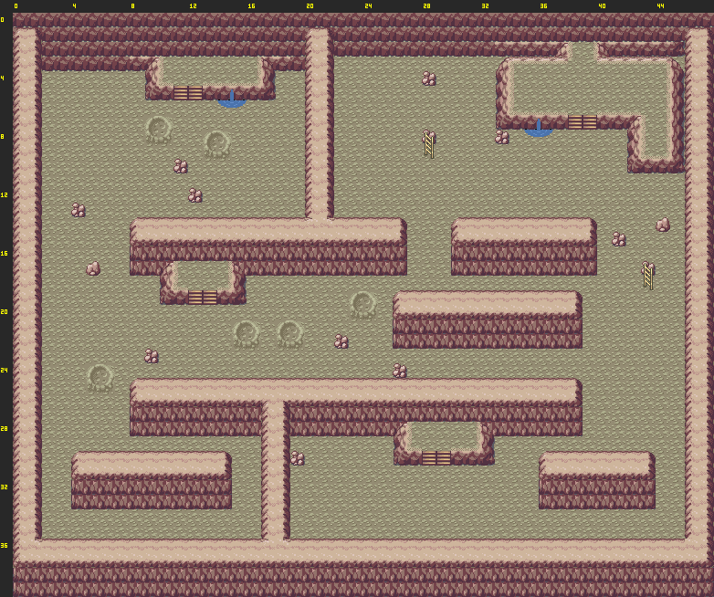<br>Terraces divided by pink-topped ridges, walled rooms entered by stairs, ladders standing in open floor, and the fossil chamber hanging from the rock at the top right. |

The vanilla maps, for comparison: [1F](images/mt_moon/vanilla_1F.png), [B1F](images/mt_moon/vanilla_B1F.png), [B2F](images/mt_moon/vanilla_B2F.png).

### How it works

The generator runs each time the player enters a Mt. Moon floor or continues a save there, during the black screen while the map loads. `src/fieldmap.c` calls it right after the floor's vanilla map has been copied into the game's map buffer, and it overwrites that copy; the map data in the ROM never changes. Some GBA background helps here:

- A map is a grid of **metatiles**, 16 × 16-pixel pictures. In memory each map cell is a 16-bit number: `metatile id | collision << 10 | elevation << 12`, so `0x3281` is cave floor (metatile `0x281`, walkable, at the floor's height 3). Drawing a floor means writing these numbers.
- The GBA has two small work memories, 32 KB of fast **IWRAM** and 256 KB of **EWRAM**, and this game uses almost all of both. So the generator keeps 16 bytes of state in IWRAM and a few event tables in EWRAM, and borrows its working grid (about 8–10 KB) from the game's heap only while a floor is being built.
- All of this runs in one go while the screen is black, so it must be fast: a floor may take at most 30 frames (half a second at the GBA's 60 frames per second) longer to load than an untouched vanilla cave (test P9).

How one floor is built (`GenerateFloor` in `src/mt_moon_gen.c`):

1. **Seed.** A fresh entry rolls a 16-bit seed with the game's `Random()` and stores it in `VAR_MT_MOON_MAP_SEED`, a game variable, so it is saved with the game; Continue reads it back. From here on every random choice comes from the generator's own random number generator, seeded from that value and the floor number, never from `Random()`. (The game advances `Random()` every frame, so anything drawn from it would come out different on Continue.)
2. **Shape.** The core proposes where the floor's two ladders (and, on B2F, the fossil chamber) go. The floor's **style** carves the cave out of solid wall around them, moving them if it likes.
3. **Checks and repairs.** The core checks the ladders, stamps the fossil chamber (a 13 × 9 block of vanilla B2F's tiles) and turns any floor the player can't walk to into wall.
4. **Content.** Every vanilla trainer, NPC, item ball, hidden item and sign gets a spot where it keeps the floor in one piece and the player can stand in front of it; where nothing fits, the core carves open floor.
5. **Drawing.** The style picks the tile for every cell; then come the stamped one-tile pieces (hidden items' boulders, the sign), the fossil chamber, and the decorations.
6. **Final check.** One last flood fill confirms that both ladders, every floor tile and every piece of content can be reached. Then each trainer that stands still is turned toward its longest open line of sight.

If a shape fails a check, the style builds a new one; after 4 failures the floor stays the vanilla map, which is fully playable. In the tests this has never happened.

**Where to look.** The core is the same for every floor; a style decides only what a floor looks like.

| File | What it holds |
|---|---|
| `include/mt_moon_gen.h` | The three entry points `src/fieldmap.c` calls: fresh entry, Continue, and "is this a generated floor". |
| `src/mt_moon_gen.c` | The core. Its OVERVIEW comment walks through all of it: the floor table (the chain, ladder kinds, vanilla decorations), the seed and random numbers, the grid, ladders, the fossil chamber, pocket filling, content placement, decorations, warps and the Continue safety net. |
| `include/mt_moon_gen_style.h` | The contract between the core and a style: the grid, the ladder and chamber rules a style must keep, one-tile prefabs and map cell values. Start here to change a floor's look. |
| `src/mt_moon_style_1f.c` | 1F: rock islands in open floor, soft-edged sand. |
| `src/mt_moon_style_b1f.c` | B1F: rooms and corridors in black void. |
| `src/mt_moon_style_b2f.c` | B2F: ridges, walled rooms with stairs, freestanding ladders, the chamber's place. |
| `data/maps/MtMoon_*/map.json`, `data/maps/Route4/map.json` | The warps. B2F's warp 1 and Route 4's warp 1 point at each other; every other link is vanilla's. |

"Looks like vanilla" is checked, not eyeballed: test P5 compares every pair of neighbouring tiles (north-south and east-west) on a generated floor with the pairs that floor's vanilla map (`data/layouts/MtMoon_<floor>/map.bin`) contains, and allows exactly one pair vanilla doesn't have: rock above the top-right corner of B2F's fossil chamber.

### Tests

Each test boots the ROM in mGBA's headless emulator and drives the game from a Lua script (see `test/run_test.sh`). Build first with `make -j$(nproc) firered`; the tests run `pokefirered.gba`.

```bash
# Property checks: every generated floor, 100 seeds each (about 3 minutes;
# the limit is generous)
MGBA_TEST_TIMEOUT=1500 bash test/run_test.sh test/tests/test_mt_moon_properties.lua
# One floor, one check, or one random state, e.g. to reproduce a logged failure
MT_MOON_FLOORS=B2F MT_MOON_CHECKS=P5-B2F MT_MOON_RNG=0x12345678 \
    bash test/run_test.sh test/tests/test_mt_moon_properties.lua
# A scenario
MGBA_TEST_TIMEOUT=300 bash test/run_test.sh test/tests/test_mt_moon_walk_east.lua
```

**Property checks** (`test/tests/test_mt_moon_properties.lua`): it enters each floor with 100 different random states and runs every check in `test/tests/mt_moon_checks/` on each cave. A new check is a new file in that directory.

| Check | Passes when |
|---|---|
| P1 ladders | Exactly 2 active warps, each on its ladder's or door's tiles, at least 24 tiles apart |
| P2 reachable | From either ladder, with every object (and a wanderer's whole roaming box) solid: the other ladder, a tile facing every object, hidden item and sign, and Miguel's trigger can be reached; every hidden item sits on a boulder |
| P3 no pockets | Every walkable tile that no object stands on can be reached |
| P4 content complete | Every vanilla object, hidden item, sign and trigger tile is on the floor, none at (0,0), none sharing a tile or on a warp |
| P5 looks right | 0 neighbouring tile pairs missing from that floor's vanilla map (one allowed B2F pair, above) |
| P6 density | Walkable share of the map: 1F 50–70%, B1F 15–30%, B2F 36–56% |
| P7 trainer facing | Each trainer that stands still faces its longest straight run of open floor |
| P8 determinism | Entering again with the same random state builds the identical map and object positions |
| P9 load time | At most 30 frames slower than entering Rock Tunnel 1F, a vanilla cave of the same size |
| P10 decorations | Rubble, craters and puddles each between ½ and 1½ times vanilla's count |
| FC fossil chamber | B2F's chamber is vanilla's tiles, with Miguel, both fossils and his trigger in place; no fossil can be reached without stepping on the trigger; the ladders connect without the chamber |
| SAND-1F | 1F's sand comes in soft-edged patches of at least 3 × 3 |
| B1F-W | B1F is generated across its full 49-tile width |

**Scenarios** (one file each in `test/tests/`; every step is a real D-pad press planned by `test/lib/walk.lua`, and every Mt. Moon trainer is first marked defeated):

| # | File | Passes when |
|---|---|---|
| S1 | `test_mt_moon_walk_east.lua` | Walking Route 4 west → 1F → B1F → B2F → Route 4 east arrives on each expected warp, ending on Route 4 at (32,5) |
| S2 | `test_mt_moon_walk_west.lua` | The same walk the other way ends on Route 4 at (19,5) |
| S3 | `test_mt_moon_miguel_trigger.lua` | Stepping on Miguel's trigger (Miguel not yet beaten) starts his battle |
| S4 | `test_mt_moon_fossil_dome.lua` | Taking the Dome Fossil sets its flags and puts it in the bag; Miguel walks to the Helix Fossil and takes it |
| S5 | `test_mt_moon_fossil_helix.lua` | The same with the Helix Fossil |
| S6 | `test_mt_moon_save_continue.lua` | Saving and continuing on each floor rebuilds the same map, seed and object positions |
| S7 | `test_mt_moon_fossil_dome.lua` | Leaving B2F after taking a fossil and coming back builds a new cave, both fossils stay gone and Miguel is back at his post |
| S8 | `test_mt_moon_items.lua` | 1F's Moon Stone ball and B2F's hidden Moon Stone can be picked up, and the ball is gone on re-entry |
| S9 | `test_mt_moon_safety_net.lua` | Continuing a save made inside a wall puts the player on reachable floor |

### Renders and the demo

`test/tools/render_cave.py` draws a whole map to a PNG with the game's own tile graphics and palettes, read straight from the repo's source files (`tiles.png`, `palettes/*.pal`, `metatiles.bin`), so it needs Python 3 and nothing else, not even a build. Its header lists everything it reads.

```bash
# A vanilla map
python3 -I test/tools/render_cave.py data/layouts/MtMoon_B2F/map.bin -o vanilla_B2F.png
# A generated cave: dump it from the running game by seed, then render the dump
MT_MOON_DUMP_FLOORS=B2F MT_MOON_DUMP_SEEDS=0x64f4 bash test/run_test.sh test/tools/dump_mtmoon_grid.lua
python3 -I test/tools/render_cave.py /tmp/mgba-test.XXXXXX/MtMoon_B2F_64f4.txt -o after_B2F.png
```

`run_test.sh` prints the run's output directory (`/tmp/mgba-test.XXXXXX`). With no settings, `dump_mtmoon_grid.lua` dumps the three "after" caves above. The demo GIF is `test/tests/demo_mt_moon.lua`, which is also a test of its own story (the arrival on every floor, the fossil, Miguel, under 45 seconds); its header has the commands that record it and turn it into the GIF.

This is a decompilation of English Pokémon FireRed and LeafGreen.

It builds the following ROM images:

* [**pokefirered.gba**](https://datomatic.no-intro.org/?page=show_record&s=23&n=1616) `sha1: 41cb23d8dccc8ebd7c649cd8fbb58eeace6e2fdc`
* [**pokeleafgreen.gba**](https://datomatic.no-intro.org/?page=show_record&s=23&n=1617) `sha1: 574fa542ffebb14be69902d1d36f1ec0a4afd71e`
* [**pokefirered_rev1.gba**](https://datomatic.no-intro.org/?page=show_record&s=23&n=1672) `sha1: dd5945db9b930750cb39d00c84da8571feebf417`
* [**pokeleafgreen_rev1.gba**](https://datomatic.no-intro.org/index.php?page=show_record&s=23&n=1668) `sha1: 7862c67bdecbe21d1d69ce082ce34327e1c6ed5e`
* [**pokefirered_switch.gba**](https://datomatic.no-intro.org/index.php?page=show_record&s=23&n=x550) `sha1: baa452d0b24629dd7782cfc07a8984085dde1311`
* [**pokeleafgreen_switch.gba**](https://datomatic.no-intro.org/index.php?page=show_record&s=23&n=x551) `sha1: 62b9fc77549dbc67032eb6cbd0ea6ad3b825690f`

To set up the repository, see [INSTALL.md](INSTALL.md).

For contacts and other pret projects, see [pret.github.io](https://pret.github.io/).
