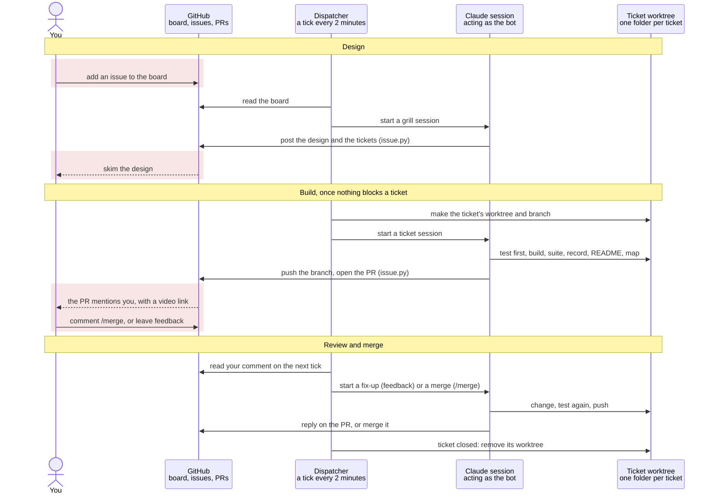
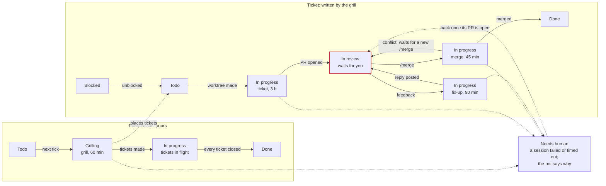
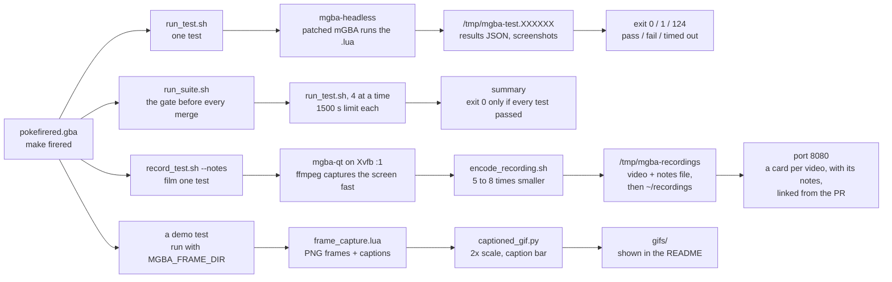

# System map

How this repo's machinery fits together: autodev, the tests, the recordings, and one line on every script. Read this first when you've lost track; the details live in the files it links to.

**In one paragraph.** You write an issue. A timer on your laptop wakes a dispatcher every 2 minutes, and the dispatcher hands the issue to headless Claude sessions that act as a bot account. They design it, split it into tickets, build each ticket in its own folder, prove it in an emulator, film it, and open a PR. Nothing reaches master until you comment `/merge`.

**Keeping it true.** A PR that changes anything on this map updates it in the same PR, and every PR body says what changes for you (CLAUDE.md, "System map"). `test/tests/test_system_map.lua` fails when a script is missing from the map or the map names a file that's gone. In the diagrams, red marks a step only you take.

## The four parts

| Part | Where | What it is |
|---|---|---|
| The game | `src/`, `data/`, `include/`, `Makefile` | The FireRed decompilation plus the fork's features (the generated Mt. Moon, the walking Pokémon, multiplayer and the rest; see `README.md`). `make firered` builds `pokefirered.gba`: `Makefile` and `config.mk` drive it, it compiles the host tools in `tools/` first, and the old compiler, agbcc, sits in `tools/agbcc` (linked into each worktree). |
| The tests | `test/` | Lua scripts drive a patched mGBA emulator: they press buttons, read game memory and assert. `test/run_suite.sh` must pass before anything merges. |
| The recordings | `test/record_test.sh`, `test/tools/recording_notes.py`, `test/serve_recordings.py`, `test/tools/captioned_gif.py`, `gifs/` | `test/record_test.sh` films a test to video so you can watch what a PR changed, encoded small enough to stream to a phone. Beside each video it keeps a notes file: which ticket, feature and PR the recording is for, what it tests, what the problem was, what you should see, and the run's result. `test/serve_recordings.py` lists the videos on a web page, newest first, each card titled with its ticket and showing its notes. `test/lib/frame_capture.lua` and `test/tools/captioned_gif.py` turn a demo's frames into the README's GIFs. |
| Autodev | `automation/` | A small Python dispatcher plus headless Claude sessions. Together they run CLAUDE.md's GitHub Issue Workflow from issue to merged PR. |

## The loop



Read it top to bottom; each column is one actor. The dispatcher never does the work itself. Each tick it reads the board and the PR comments, decides what should happen next, and starts a Claude session for it. The session does the work and reaches GitHub only through `automation/bin/issue.py`. Your comment on a PR is read on the next tick, at most 2 minutes later. At most 2 sessions run at once.

**Where you come in:**

1. Write an issue and add it to the **pokefirered autodev** board.
2. Skim the design comment the grill session posts, starting with its **Least-confident defaults** list. Set the card to `Paused` if you want to stop work and rethink.
3. Review each PR: the diff, its **What changes for you** section, the recording link and the branch README.
4. Comment exactly `/merge` to approve it. Any other comment is feedback, and a fix-up session handles it.
5. Rescue anything in `Needs human`. The bot's comment says what went wrong and ends with a command that reopens that session where it stopped.

**Three facts that explain most surprises:**

- **CLAUDE.md is the program.** Each session's prompt in `automation/prompts/` is a few lines that say "follow CLAUDE.md, Autonomous mode". What a session actually does comes from CLAUDE.md's GitHub Issue Workflow, so editing `CLAUDE.md` changes how the AI behaves.
- **Autodev updates itself.** Every tick starts with `git pull` on autodev's own clone, so a change merged into `automation/` or `CLAUDE.md` is live within about 2 minutes, with no restart. The recordings page is a program that keeps running, so it would keep its old code: when a merge has changed `test/serve_recordings.py` since the page started, the tick restarts it (`automation/autodev/recordings.py`). That's the only time autodev cuts off a video you're watching. A page you stopped stays stopped.
- **Only your words get in.** Sessions see text written by you or the bot and nothing else, because the repo is public and a stranger's comment could carry instructions. Only your exact `/merge` merges.

## Board columns



A parent you write is grilled into tickets. Each ticket waits for its blockers, gets its own session, and ends in a PR that waits for you in `In review`. Feedback starts a fix-up; `/merge` starts a merge. Any session that fails or hits its time limit, a grill included, parks its card in `Needs human`. The rules are in `automation/autodev/decide.py`.

- **`Paused` is your stop switch.** Nothing new starts for that card, or for any ticket of a paused parent. A session already running finishes its run. Move the card back to `Todo` to carry on: a parent with tickets isn't grilled again, and a ticket with an open PR goes straight to review.
- **Usage limit.** When a session hits the Claude usage limit, no session of any kind starts until 5 minutes after the reset, and the interrupted work is queued again.
- **Crashes.** The first crash re-queues the work. A second crash in a row for the same role and issue parks it in `Needs human`.
- **Closing a ticket yourself** counts as done: its worktree is removed and the tickets it blocked move on.
- **Closed cards leave the board.** The board's "Auto-archive items" workflow archives a card within seconds of its issue closing, and autodev doesn't need the card. It counts a parent's tickets from the parent's sub-issues on GitHub, so the parent still closes once they all have. A closed ticket still loses its worktree, and autodev never tries to set the Status of a card that's gone.

## Session roles

| Role | Starts when | What it does | Runs in | Limit, effort |
|---|---|---|---|---|
| grill | Your new issue (no `## Parent` heading) is in `Todo` | CLAUDE.md steps 1–4. It grills the idea on its own, taking its own recommended answer each round, posts the design with a Least-confident defaults list, rewrites the issue body as a scope summary and creates the tickets. It can't edit code. | autodev's clone | 60 min, max |
| ticket | A ticket is in `Todo` and nothing it's blocked by is open | Steps 7–11: test first, clean build, full suite, a recording with notes, README and this map, code review, then a PR that @mentions you, says what changes for you and links each recording's own page. Once the PR is open, it puts the PR's number into each recording's notes (`set-pr`). | its own worktree | 3 h, xhigh |
| fix-up | Your newest unhandled PR comment is anything but `/merge` | Handles all your unhandled comments at once, runs the tests again, records again with notes if the game changed (the PR's number goes in by itself), pushes, and replies on the PR saying what it did about each one. | the ticket's worktree | 90 min, xhigh |
| merge | Your newest unhandled PR comment is exactly `/merge` | Merges master in, builds, runs the unit tests and the suite on that tree, then merges with a merge commit. On a conflict it resolves it, explains on the PR, and waits for a fresh `/merge`. | the ticket's worktree | 45 min, xhigh |

At most 2 sessions run at once, all on Opus (`automation/config.json`). When more are waiting, merges go first, then fix-ups, then tickets, then new issues, so finishing work beats starting more. Within merges, fix-ups and tickets, the feature grilled first goes first, so its tickets finish before a later feature's start. A new issue is still grilled whenever a slot is free and nothing above wants it. Time limits and effort levels are set in `automation/autodev/sessions.py`.

## Guardrails

| Guard | What it does |
|---|---|
| Bot account | Everything autodev does on GitHub is done as **MinimalEffort07-Autodev**. Its token lives in `~/.config/autodev/env` and reaches only this repo. Its PRs and comments notify you like anyone else's. |
| `automation/bin/issue.py` | The only way a session reaches GitHub; plain `gh` is denied. It hides text from anyone but you and the bot, acts only on the session's own issue, and gives each role only the commands it needs. It refuses a PR body without Fixes #T, an @mention of you, or a "What changes for you" section. |
| Deny rules per role | `automation/settings/<role>.json`: no pushing to master, no force-push, no deleting branches, nothing on `pret/pokefirered`. Sessions load the clone's copy, so a session can't loosen its own rules by editing its worktree. |
| Master rulesets | GitHub itself blocks force-pushes and deleting master, and the bot can change master only by merging a PR. |
| Your `/merge` | It counts only while it's your last word on the PR. The merge is always of the exact commit that passed the suite after master was merged in; if master moves on meanwhile, the merge is refused. |

## How a change is proven



All four paths start from the same ROM. The top two prove the change and need no screen, so they run alongside anything. The bottom two make pictures for a person: a video for each PR, and GIFs for the README. `README.md`'s "Tests" section has the rules in full.

- **A test passes only by proving something.** Zero assertions counts as a fail. Demos and probes say so with `fw.allow_no_assertions`, and the suite skips them: `test/suite_exclude.txt` lists each skipped test with its reason.
- **Each run gets its own folder** (`/tmp/mgba-test.XXXXXX`), so several worktrees can test at the same time. The suite deletes the folders of passing runs and keeps failures with their `run_test.log`.
- **Recordings take turns.** `test/record_test.sh` films the whole virtual display, so it holds a machine-wide lock (`/tmp/autodev-record.lock`) and a second recording waits.
- **Recordings are small enough to stream.** The live capture is fast but big (about 3 Mbps). Once it ends and the lock is released, `test/tools/encode_recording.sh` encodes it again, slowly and well, into `/tmp/mgba-recordings`: 5 to 8 times smaller, with the scripting log as readable as before. If that encode fails, the capture is kept as the video.
- **Recordings carry notes.** `record_test.sh --notes FILE` takes a few lines saying which ticket, feature and PR the recording is for, what it tests, what the problem was and what you should see. It checks them before it waits for the lock, so bad notes cost a second, not a recording (`--check` only checks). Every video then gets `<name>.json` beside it, with the notes, when it was recorded, the test, the branch and commit, and the run's result; the script's last lines are the `mv` that keeps both files and the recording's own page.
- **Autodev's recordings always carry notes.** In a session autodev started, `test/record_test.sh` refuses to record without notes, or with notes for another ticket or without the parent. Each PR links its recordings' own pages, and `test/tools/recording_notes.py set-pr` puts the PR's number into their notes once the PR exists (a fix-up's get it by themselves). Your own recordings may still leave notes out.
- **The tests need the patched mGBA** in `~/projects/minimaleffort/mgba/build` (a screenshot fix and a fast-forward scripting API). Stock mGBA won't do.
- **Autodev has its own unit tests** in `automation/tests/`, run with `cd automation && python3 -m unittest`. About half of them pin down the rules in `automation/autodev/decide.py`.

## Every script

Each script, by its path from the repo root. `test/tests/test_system_map.lua` checks that every `.sh`, `.py`, `.pl` and `.lua` file directly in the top level, `.github/calcrom/`, `automation/`, `automation/bin/`, `automation/autodev/`, `test/`, `test/lib/` and `test/tools/` is here. Tests, prompts and settings are described as groups.

**Autodev** (`automation/README.md` has every rule):

| Script | What it does |
|---|---|
| `automation/setup.sh` | Sets up everything a script can: the board, the bot's access, the master rulesets, autodev's clone, the systemd units. Safe to run again; it ends "setup: no changes" when nothing is left to do. |
| `automation/wizard.sh` | Walks you through what only a person can do: the bot account and token, `gh`'s project scope, the Windows logon task that keeps WSL awake. |
| `automation/config.json` | Names and paths: owner, bot, board title, the 2-session cap, model, clone, log and state folders. |
| `automation/autodev/__main__.py` | The entry point the timer runs: `python3 -m autodev tick`. |
| `automation/autodev/dispatcher.py` | **One tick.** Restarts the recordings page if a merge changed it (`automation/autodev/recordings.py`), then gathers the board, each open parent's tickets among its sub-issues, and what finished sessions left on GitHub, asks `automation/autodev/decide.py` what to do, carries it out, logs it to the journal. |
| `automation/autodev/decide.py` | **The rules,** as one pure function: state in, list of actions out. Priority, blocking, `/merge`, crashes and usage limits all live here. |
| `automation/autodev/board.py` | Reads the Projects board through GitHub's GraphQL API. |
| `automation/autodev/github.py` | Carries out actions on GitHub, lists which of a parent's sub-issues are its tickets, and checks whether a finished session really left its design, tickets, PR or reply. |
| `automation/autodev/gh.py` | The GitHub adapter: runs `gh api` as a subprocess, with the bot's token. |
| `automation/autodev/sessions.py` | Starts each `claude -p` run in its own systemd unit with the role's time limit and effort, then reads back its result and any usage-limit message. |
| `automation/autodev/registry.py` | The dispatcher's memory between ticks: which sessions it started, crash counts, the usage-limit pause. |
| `automation/autodev/worktrees.py` | Makes and removes each ticket's worktree and branch, with `tools/agbcc` linked. |
| `automation/autodev/recordings.py` | Restarts the recordings page on a tick when its code changed since it started, so a merged change to the page shows within about 2 minutes. |
| `automation/autodev/config.py` | Loads `automation/config.json`. |
| `automation/bin/issue.py` | The sessions' only way to reach GitHub. |
| `automation/autodev/issue_tool.py` | The trust and per-role rules `automation/bin/issue.py` enforces. |
| `automation/prompts/<role>.md` | The few lines each session starts with. They point at CLAUDE.md. |
| `automation/settings/<role>.json` | Each role's permissions, written as deny rules. |
| `automation/tests/` | The unit tests, with fakes for GitHub and systemd. |

**Tests and media** (`README.md`, "Tests"):

| Script | What it does |
|---|---|
| `test/run_test.sh` | Runs one Lua test in headless mGBA. Exit 0 pass, 1 fail, 124 timed out. |
| `test/run_suite.sh` | Runs every top-level test, 4 at a time, in about 10 minutes. Must pass before a merge. |
| `test/suite_exclude.txt` | The tests the suite skips, each with a one-line reason. The suite refuses to start on a line without one. |
| `test/record_test.sh` | Runs a test in the mGBA window on a virtual display and films it to mp4. It captures fast, then encodes the video small enough to stream with `test/tools/encode_recording.sh`, after it has let the next recording start. `--notes FILE` says what the recording is for; the notes are checked before anything starts (`--check` only checks), a ticket they name starts the video's name, and every video gets a notes file beside it. An autodev session must give notes, for its own ticket. It ends with the `mv` that keeps both files and the recording's page. |
| `test/serve_recordings.py` | The recordings page on port 8080, run by `autodev-recordings.service`: the videos newest first, each with its own page. A card shows its notes file: the ticket as its title, the parent and PR, the three notes, and when, the test, the branch and commit and the result. An old video given notes with `add-notes` says "notes added <date>" instead of a result. A video without a notes file gets a title from its file name. `--port 8081` previews a branch's page. `test/tests/test_recordings_page.lua` and `test/tests/test_recording_notes.lua` check it. The dispatcher restarts it when a merge changes this file, so it must stay one file that imports only Python's standard library, and it reads the notes files itself. |
| `test/mgba-qt.sh` | Opens the patched mGBA window by hand. |
| `test/lib/framework.lua` | The test framework: press buttons, wait frames, assert, write results. Every test loads it. |
| `test/lib/addresses.lua` | Where game variables sit in memory, for the older tests that hard-code addresses. |
| `test/lib/symbols.lua` | Looks addresses up by symbol name in the built `pokefirered.elf`, so tests survive the addresses moving. |
| `test/lib/walk.lua` | Walks the player somewhere for real: plans a route over the loaded map and presses the D-pad one tile at a time. |
| `test/lib/warp.lua` | Warps the player straight to a map, for tests and tools that don't need the walk. |
| `test/lib/character_select.lua` | Boots a new game through Oak's speech to the character list. |
| `test/lib/frame_capture.lua` | With `MGBA_FRAME_DIR` set, saves every second frame and its caption for a GIF; it can pause, so a warp the demo makes isn't filmed. |
| `test/lib/follower.lua` | The walking Pokémon harness: a save state with it walking, where it stands, putting it on a tile (its sprite too, so recordings show it there), the per-frame walkable-tile rule, and a record of each time you swap places with it (a swap may leave it on a doormat or ladder, which the rule allows until its next step). |
| `test/lib/poke_radar.lua` | Reads and writes the Poké Radar chain state, and plays the radar. |
| `test/lib/route14_battle.lua` | Starts the Kiri and Jan double battle on Route 14, for the type-colour tests. |
| `test/lib/mt_moon.lua` | The Mt. Moon harness: enter a floor with a chosen random state, read back the generated cave, search it, save and Continue. |
| `test/lib/mt_moon_chain.lua` | Walks the whole Mt. Moon chain on foot, east or west. |
| `test/lib/mt_moon_chamber.lua` | B2F's fossil chamber as the tests see it. |
| `test/lib/mt_moon_fossil.lua` | Takes a fossil in the chamber: the flow both fossil scenarios share. |
| `test/lib/mt_moon_tiles.lua` | Compares a generated floor's tiles with vanilla's, for the look and density checks. |
| `test/tests/` | The tests and demos. `test/tests/mt_moon_checks/` holds the Mt. Moon property checks. `suite_fixtures/` and `framework_fixtures/` hold the small scripts that `test/tests/test_run_suite.lua` and `test/tests/test_framework_rules.lua` run to check the runners. |
| `test/demos/` | A demo kept outside the suite. |
| `test/tools/captioned_gif.py` | Turns a demo's captured frames into a captioned README GIF (`--font-size` for long captions). |
| `test/tools/recording_notes.py` | A recording's notes for `test/record_test.sh`: `check` checks them, `ticket` gives the ticket number for the video's name, `write` writes the notes file beside the video with what the recorder knows (when, the test, the branch and commit), and `set-result` adds the run's result once the test has finished. In an autodev session it also holds the notes to the session's rules (its own ticket, a parent, the PR filled in). `set-pr NAME PR` puts a PR's number into a kept or fresh recording's notes, for a ticket session once its PR is open. `add-notes NAME NOTES` gives notes to a video kept before notes existed, without moving it on the page: its time comes from the name's stamp or the video's modification time, never from now, and the unknown facts stay null. It never touches a notes file `test/record_test.sh` wrote. Its header has the notes' rules and the file's format. |
| `test/tools/encode_recording.sh` | Encodes one recording small enough to stream, 5 to 8 times smaller than the live capture. The settings live only here, each explained. `test/record_test.sh` and `test/tools/shrink_recordings.sh` use it. |
| `test/tools/shrink_recordings.sh` | Shrinks the videos already kept (`~/recordings` by default) the same way, keeping their names and times, and moves each original into `originals/` there. Safe to run again: it only touches videos not shrunk yet. |
| `test/tools/render_cave.py` | Draws a map, vanilla or a dumped generated cave, to PNG. |
| `test/tools/dump_mtmoon_grid.lua` | Dumps generated Mt. Moon caves by seed for `test/tools/render_cave.py`. |
| `test/tools/create_route14_battle_fixture.lua` | Saves a state inside the Route 14 double battle, for checking the colours by hand. |
| `test/tools/warp_to_route1.lua` | Makes the Route 1 savestate fixture that `test_roaming_route1` needs. |
| `test/tools/warp_to_route1_grass.lua` | Makes the Route 1 tall-grass fixture used by the shiny-chaining tests. |
| `test/tools/save_route1_state.lua` | The older, by-hand way to make the Route 1 fixture. |
| `test/tools/explore_route1.lua` | Probe: random-walks Route 1 looking for tall grass. |
| `test/tools/probe_route1_fixture.lua` | Probe: logs the tiles around the player in the grass fixture. |
| `test/tools/test_route1_movement.lua` | Probe: tries walking each way from the Route 1 fixture. |

**Leftovers from upstream pret** you can ignore:

| Script | What it does |
|---|---|
| `build_tools.sh`, `asmdiff.sh`, `compare.sh`, `replace.sh` | Upstream helpers, untouched since 2019–2020. |
| `docs/bugs_and_glitches.md`, `docs/legacy_WSL1_INSTALL.md` | Upstream docs. |
| `docs/superpowers/` | This fork's plans and a spec from April 2026, from before autodev. History only. |
| `.github/workflows/build.yml`, `.github/calcrom/calcrom.pl`, `.github/calcrom/webhook.sh` | Upstream's CI and its progress counter. The workflow builds with `COMPARE=1`, which can't pass on this fork, and it has never run here: the suite is this fork's check. |

## On this machine

| Path | What it is |
|---|---|
| `~/projects/minimaleffort/pokefirered` | Your own checkout, where you work. Autodev never touches it. |
| `~/projects/minimaleffort/pokefirered-autodev` | Autodev's clone, pulled from master on every tick. Sessions use its `automation/settings/` and `automation/bin/issue.py`. Grill sessions run here. |
| `~/projects/minimaleffort/pokefirered-autodev-worktrees/issue-<T>` | One folder per open ticket, on branch `issue-<T>-<slug>`. Deleted once the ticket closes. |
| `~/projects/minimaleffort/mgba/build` | The patched emulator every test runs on. |
| `~/autodev/logs/` | Each session's full log, `<role>-<issue>-<time>.jsonl`, kept 30 days. |
| `~/.local/state/autodev/sessions/` | The dispatcher's records. Delete `paused-until` there to lift a usage-limit pause early. |
| `~/.config/autodev/env` | The bot's token. Mode 600, never committed. |
| `/tmp/mgba-test.*`, `/tmp/mgba-recordings/` | Per-run test folders, and fresh videos with their notes files. Cleared on reboot. |
| `~/recordings/` | Videos kept for good, each `<name>.mp4` with its notes file `<name>.json` (videos recorded before notes existed have none until `add-notes` gives them notes). |
| `~/recordings/originals/` | The full-size originals of the videos `test/tools/shrink_recordings.sh` shrank. The recordings page doesn't list them. Put one back with `mv`, or delete the folder once you're happy. |

## Check on it

```bash
systemctl --user list-units 'autodev-*'        # autodev's units; a session is autodev-<role>-<issue>
journalctl --user -u autodev-dispatcher -f     # watch each tick live
systemctl --user list-timers autodev.timer     # when the next tick is due
ls -t ~/autodev/logs | head                    # newest session logs
systemctl --user stop autodev.timer            # no new ticks until you start it or the machine restarts
systemctl --user start autodev.timer           # ticks again (disable --now / enable --now: for good)
```

Recordings: http://100.76.129.86:8080 (`python3 test/serve_recordings.py`, run by `autodev-recordings.service`).
